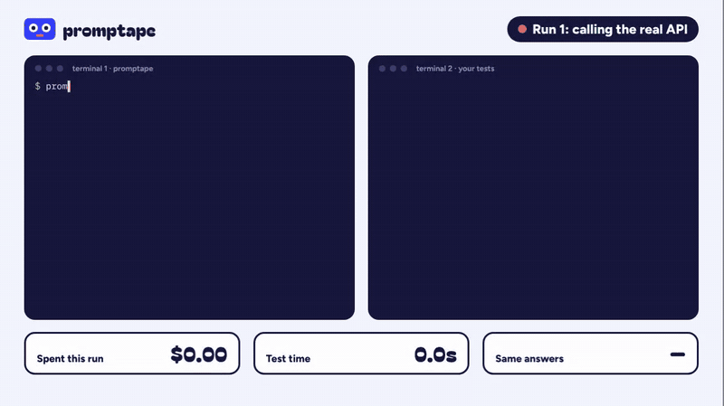

<div align="center">

# ◉ promptape

**Record your LLM API calls once. Replay them forever.**

A tiny local proxy that makes AI test suites free, instant and deterministic.<br>
Works with the official OpenAI and Anthropic SDKs, in any language, with one environment variable.

[](https://github.com/promptape/promptape/actions/workflows/ci.yml)
[](https://github.com/promptape/promptape/releases)
[](LICENSE)

**[Website](https://promptape.github.io/promptape/)** · [Quick start](#quick-start) · [How it works](#how-it-works) · [CI](#use-it-in-ci) · [Tapes](#tapes) · [FAQ](#faq)

</div>

<p align="center">
  
  <br><sub>Illustrative run of a 40-call test suite. <a href="examples/python">Try it yourself in 2 minutes</a>.</sub>
</p>

---

Every test that calls a real model **costs money**, **takes seconds**, **returns something slightly different each time** and **fails when the provider is rate-limiting or down**. Mocking by hand means writing fake responses that drift from what the API really returns.

Promptape sits between your code and the API:

```
your app / tests ──► promptape (localhost:4000) ──► api.openai.com / api.anthropic.com
                         │
                         └── tapes/  ← real responses, saved as readable JSON, committed to git
```

- **First run:** calls go to the real API and the real responses are recorded.
- **Every run after:** responses come from the tape. $0, milliseconds, identical every time, fully offline.

```
  ◉ promptape v0.1.0  mode=auto (replay if recorded, otherwise record)

  RECORD anthropic claude-opus-5-5   POST /v1/messages          2.4s  cost $0.01 → tapes/anthropic/claude-opus-5-5-252590dd6997.json
  REPLAY anthropic claude-opus-5-5   POST /v1/messages          310µs saved $0.01
  REPLAY openai    gpt-5             POST /v1/chat/completions  205µs saved $0.0045
```

## Quick start

**1. Install** (single static binary, no dependencies)

```bash
go install github.com/promptape/promptape/cmd/promptape@latest
# or
docker run --rm -p 4000:4000 -v "$PWD/tapes:/tapes" --user "$(id -u):$(id -g)" ghcr.io/promptape/promptape
# or download a binary: https://github.com/promptape/promptape/releases (Linux, macOS, Windows · amd64/arm64)
```

**2. Start it and point your SDK at it**

```bash
promptape                                   # listens on 127.0.0.1:4000, mode=auto
export OPENAI_BASE_URL=http://127.0.0.1:4000/v1
export ANTHROPIC_BASE_URL=http://127.0.0.1:4000
```

**3. Run your tests twice.** The first run records; the second costs nothing. (No tests handy? [`examples/python`](examples/python) is a ready-made app to try it on.)

```bash
pytest            # records real responses into ./tapes
pytest            # replays them: free, instant, deterministic
promptape report  # what a live run of this suite would have cost
```

No code changes. Both official SDKs read those environment variables, and so do most frameworks built on them (LangChain, LlamaIndex, Vercel AI SDK, …). Anything OpenAI-compatible works too: point `--openai-upstream` at OpenRouter, Groq, Together, Azure, vLLM or Ollama.

## How it works

| Mode | Behaviour | Use it for |
|---|---|---|
| `auto` (default) | Replay if a tape exists, otherwise call the API and record | Local development |
| `replay` | Never touches the network. Unrecorded requests fail with a clear error | CI |
| `record` | Always call the API and overwrite tapes | Refreshing recordings after a prompt or model change |
| `passthrough` | Forward everything, record nothing, still measure cost | Debugging |

- **Matching** — requests are matched on provider, method, path, query and the JSON body with keys sorted and whitespace removed, so SDK formatting differences never cause a miss. Ignore volatile fields with `--ignore-fields user,metadata`.
- **Streaming** — server-sent events are relayed to your app as they arrive while recording, and replayed byte-for-byte. Use `--replay-speed 1` to reproduce the original latency and token cadence (great for testing loading states), or leave it at `0` for instant replays.
- **Repeated calls** — in `auto` mode you pay for each unique request once, even with a long-running proxy: identical requests replay the first recording. When a test makes the same request several times and needs *different* answers (agent loops, "roll a die"), record it with `--mode record`: every response is kept and replayed in order, wrapping around so each test run sees the same sequence. `POST /_promptape/rewind` restarts all sequences.
- **Errors** — deterministic errors (e.g. a 400 for a bad request) are recorded so you can test your error handling. Transient ones (429, 408, 5xx) are passed through but never saved.
- **Cost** — usage from every response is priced per model, so you see what each call cost and what each replay saved.

## Use it in CI

Record locally, commit `tapes/`, and replay in CI with zero API keys and zero spend:

```yaml
# .github/workflows/test.yml
- name: Start promptape
  run: |
    go install github.com/promptape/promptape/cmd/promptape@latest
    promptape serve --mode replay &
    until curl -sf http://127.0.0.1:4000/_promptape/health; do sleep 0.2; done
- name: Test
  run: pytest
  env:
    OPENAI_BASE_URL: http://127.0.0.1:4000/v1
    ANTHROPIC_BASE_URL: http://127.0.0.1:4000
    OPENAI_API_KEY: replay-only    # SDKs require a key to be set; it is never used
    ANTHROPIC_API_KEY: replay-only
```

If a test makes a request that was never recorded, it fails immediately with a message naming the missing tape, instead of silently calling a paid API.

## Tapes

Tapes are plain JSON under `tapes/<provider>/<model>-<hash>.json`, one file per unique request, readable in code review:

```json
{
  "promptape": 1,
  "provider": "anthropic",
  "request": {
    "method": "POST",
    "path": "/v1/messages",
    "headers": { "Anthropic-Version": "2026-10-21", "Content-Type": "application/json" },
    "body": { "model": "claude-opus-5-5", "max_tokens": 1024, "messages": [ … ] }
  },
  "interactions": [
    {
      "status": 200,
      "latency_ms": 2412,
      "stream": [ { "at_ms": 640, "data": "event: message_start\ndata: {…}" }, … ],
      "usage": { "model": "claude-opus-5-5", "input_tokens": 1200, "output_tokens": 300 }
    }
  ]
}
```

**Secrets never reach disk.** Only an allowlist of request headers is saved (`Content-Type`, `Anthropic-Version`, `Anthropic-Beta`, `OpenAI-Beta`) — `Authorization`, `x-api-key` and cookies are always dropped — and bodies are scanned for OpenAI, Anthropic, Google, GitHub, AWS, Slack and Hugging Face key formats, which are replaced with `[REDACTED]`. Your key is forwarded to the real API while recording and nowhere else.

## Cost report

```
$ promptape report        # example output

MODEL               TAPES   RESPONSES   TOKENS   LIVE COST
claude-opus-5-5     41      58          212400   $1.92
gpt-5-mini          17      17          30210    $0.04

58 tapes · 75 responses · 242610 tokens
Every replayed run saves ~$1.96 and ~3m12s of API wait time.
```

Prices are a built-in snapshot (see `internal/cost/cost.go`) and will drift; override or extend them with `--prices prices.json` (see [`prices.example.json`](prices.example.json)). Unknown models are reported as *unpriced*, never guessed. Live session totals are at `GET /_promptape/stats` and are printed when promptape exits.

## Configuration

| Flag | Env | Default | |
|---|---|---|---|
| `--mode` | `PROMPTAPE_MODE` | `auto` | `auto`, `record`, `replay`, `passthrough` |
| `--dir` | `PROMPTAPE_DIR` | `tapes` | Where tapes live |
| `--host` / `--port` | `PROMPTAPE_HOST` / `PROMPTAPE_PORT` | `127.0.0.1` / `4000` | Listen address |
| `--openai-upstream` | `PROMPTAPE_OPENAI_UPSTREAM` | `https://api.openai.com` | Any OpenAI-compatible API |
| `--anthropic-upstream` | `PROMPTAPE_ANTHROPIC_UPSTREAM` | `https://api.anthropic.com` | |
| `--replay-speed` | `PROMPTAPE_REPLAY_SPEED` | `0` | `0` instant, `1` original timing |
| `--ignore-fields` | `PROMPTAPE_IGNORE_FIELDS` | | Body fields left out of matching |
| `--prices` | `PROMPTAPE_PRICES` | | Extra or corrected model prices |
| `--quiet` | `PROMPTAPE_QUIET` | | Only print the banner and summary |

**Routing.** Requests to `/v1/messages`, or carrying an `anthropic-version` header, go to Anthropic; everything else goes to the OpenAI-compatible upstream. Prefix a path with `/openai` or `/anthropic` to force a provider. Responses carry `X-Promptape: replay | record | passthrough | miss`.

## FAQ

**Should I commit tapes?** Yes. They make your tests reproducible for everyone, they are reviewable in PRs (you see exactly how the model's answer changed when you change a prompt), and they contain no credentials.

**My prompt changed and now the test misses.** That is the point: a different prompt is a different request. Run once with `--mode auto` (or `record` to refresh everything) and commit the new tape.

**Isn't replaying the same answer hiding model regressions?** Replays test *your* code: parsing, tool handling, retries, UI. To evaluate the *model*, run your evals live (`--mode record` on a schedule) and diff the tapes.

**Does it work with Python / TypeScript / Go / Java / …?** Yes. It is an HTTP proxy, so any SDK or plain HTTP client that lets you change the base URL works.

**How do upstream URLs combine?** The path your SDK calls is appended to the upstream URL (a duplicated `/v1` is collapsed). For OpenRouter use `--openai-upstream https://openrouter.ai/api`. For Gemini's OpenAI-compatible endpoint use `--openai-upstream https://generativelanguage.googleapis.com/v1beta/openai` with `OPENAI_BASE_URL=http://127.0.0.1:4000` (no `/v1`).

**What is not supported yet?** Gemini's native API (use its OpenAI-compatible endpoint for now), WebSocket/Realtime APIs, and multipart uploads are recorded as raw bytes rather than readable JSON. See the roadmap.

## Roadmap

- [x] **v0.1** — OpenAI + Anthropic, streaming, record/replay/auto/passthrough, secret redaction, cost report, Docker image
- [ ] **v0.5** — Gemini native API, failure injection (429 / 529 / timeouts / cut-off streams), pytest & Vitest plugins, GitHub Action
- [ ] **v1.0** — local-model fallback via Ollama, drift detection, local tape browser, Testcontainers module
- [ ] **v2.0** — MCP server and agent tool-call emulation

## Development

```bash
make test   # go vet + unit and integration tests with the race detector
make e2e    # records and replays through the real OpenAI and Anthropic Python SDKs
make dist   # cross-compiled release archives
```

Promptape has **zero dependencies** outside the Go standard library.

## License

[MIT](LICENSE)
